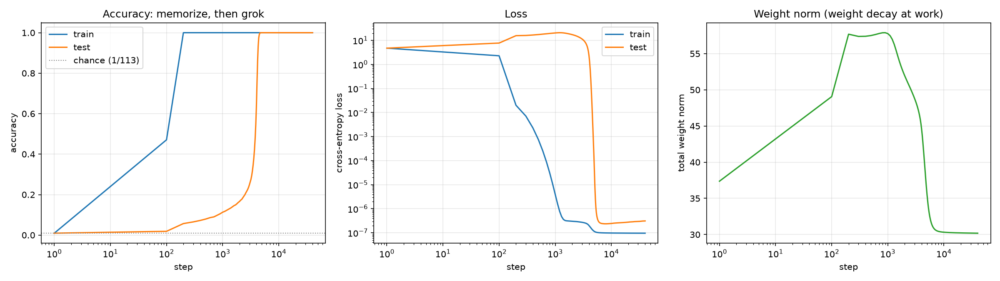
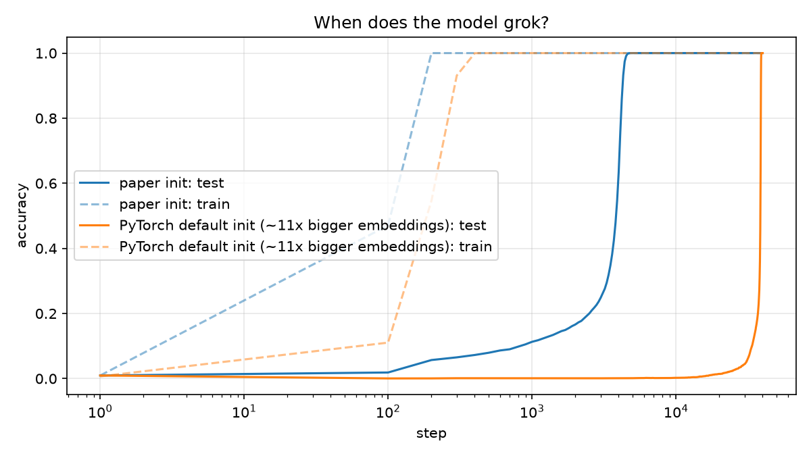
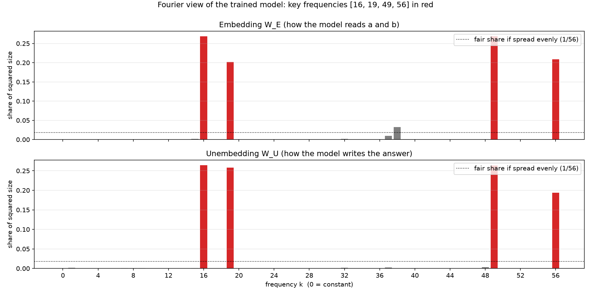
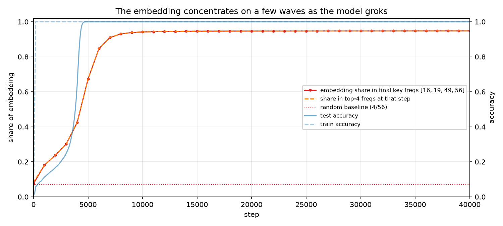
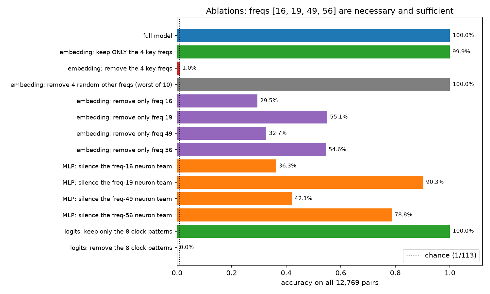
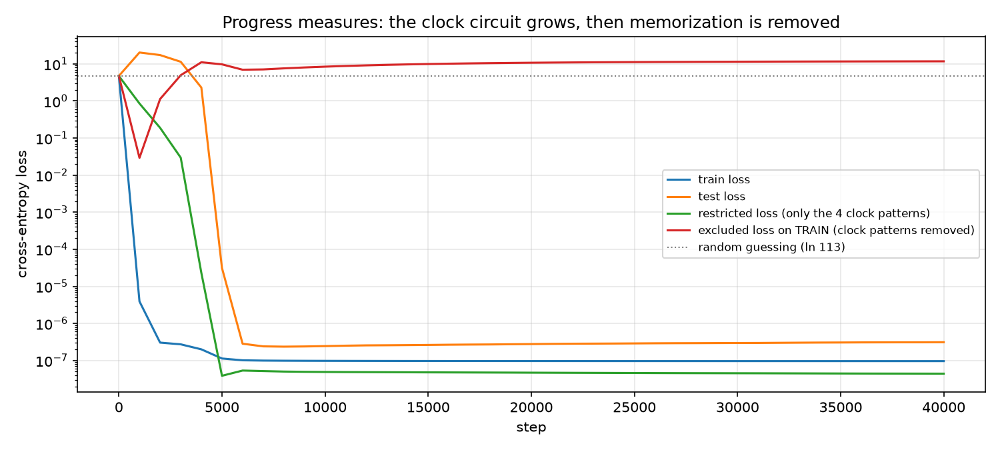
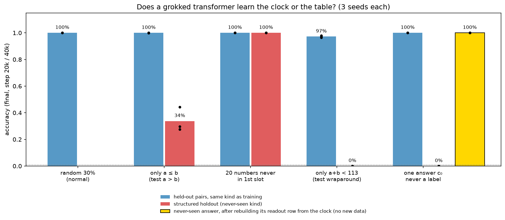
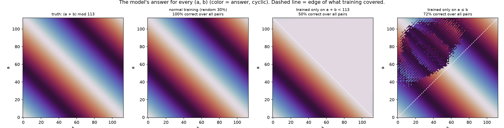
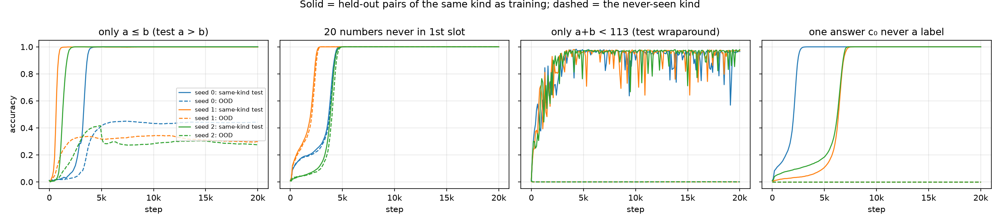

# Grokking Modular Addition: Clock or Table?

A 1-layer transformer trained on `(a + b) mod 113` memorizes its training set in 200 steps, looks stuck
for thousands more, then suddenly generalizes (**grokking**). This repo reproduces that from scratch,
reverse-engineers the algorithm the network learns (it adds numbers by rotating them around a circle), proves
the algorithm with ablations, and then runs a new experiment:

> **If the network really learned a clock, it should handle kinds of inputs it has never seen.**
> Train on structured splits (never a wraparound, never `a > b`, never a certain answer, never a certain
> number in the first slot) and test on exactly what was left out.

Parts 1–2 reproduce Nanda et al. 2023 ([arXiv 2301.05217](https://arxiv.org/abs/2301.05217)).
Part 3 is our own experiment: we searched for prior work on these structured holdouts and didn't find it
(see *Prior work* at the end of Part 3).

**Results in one table.** Each structured split trains on exactly 3,830 pairs (same as normal), 3 seeds each.

| Trained without… | Same-kind test pairs | The never-seen kind | Verdict |
|---|---|---|---|
| (normal random 30%) | 100% (3/3 seeds) | n/a | groks at step 4.5k / 6.6k / 6.9k |
| any number in the **first slot** (20 numbers) | 100% | **100%** (3/3) | clock: transfers across positions |
| any **wraparound** (only a + b < 113) | 97% | **0%** (3/3) | **number line**: answers 112 for 89–100% of wraparound pairs |
| any **a > b** (only a ≤ b) | 100% | **34%** (27–44%) | table: right only near the diagonal |
| one **answer c₀** as a label | 100% | **0%** (3/3) | clock, but its readout row is deleted. **Rebuilding it from the other 112 rows → 100%** (3/3), with no new data |

**Takeaway:** a grokked network learns the simplest rule *that its training data forces*, not "the" rule. When
the data never shows a wraparound, ordinary addition is just as consistent and it learns that instead. When
every answer is seen, it learns a real clock. That clock even computes answers it was never trained to output,
but weight decay deletes the unused readout row, so the knowledge is invisible until you put the row back.


---

## Part 1: Grokking, reproduced



| | Train acc ≥ 99% | Test acc ≥ 99% |
|---|---|---|
| Paper initialization | step 200 | **step 4,500** |
| PyTorch default initialization (embeddings ~11× larger) | step 400 | **step 39,100** |

- Setup: 1-layer transformer (d_model 128, 4 heads, MLP 512, no LayerNorm, 226,688 params), trained
  full-batch with AdamW (lr 1e-3, **weight decay 1.0**) on a random 30% of all 12,769 pairs.
- Starting weights ~11× larger delayed grokking ~9× (one seed each). This is consistent with weight
  decay needing longer to shrink a larger memorizing solution (Liu et al. 2022, *Omnigrok*).



## Part 2: What the network learned, and proof

**It represents every number as 4 waves.** Projecting the embedding onto the Fourier basis
(cos/sin of 2πk·x/113), 4 frequencies, **k = 16, 19, 49, 56**, hold **94.8%** of the embedding and **98.1%**
of the unembedding. All 512 MLP neurons specialize to one of these 4 frequencies (467 cleanly).



**The waves form long before the jump.** The embedding's share in those 4 frequencies rises smoothly
from step 0 (7.5% → 42% at step 4k → 94% at 10k). The final 4 frequencies are already the top 4 by step 1,000.



**Ablations: the 4 frequencies are necessary and sufficient.**

| Edit (scored on all 12,769 pairs) | Accuracy |
|---|---|
| Keep ONLY the 4 key frequencies in the embedding | 99.9% |
| Remove the 4 key frequencies | 1.0% (chance = 0.9%) |
| Control: remove 4 random other frequencies (10 tries) | 100% (every try) |
| Logits restricted to the 8 patterns cos/sin(w_k(a+b−c)) | 100% |
| Logits with those 8 patterns removed | 0% |

The 8 "clock" patterns explain 93.5% of the variance of the logits. So the output is literally
`logit(c) ≈ Σ_k α_k cos(w_k (a + b − c))`, which peaks exactly at `c = a + b mod 113`.



**Progress measures.** The clock part of the logits alone already reaches loss 0.19 at step 2,000, while the
test loss is still ~17. The circuit exists but is buried under memorization. The non-clock part (the
memorized table) gets erased by weight decay around steps 3k–4.5k, and that's when test accuracy jumps.



## Part 3 (new): Clock or table? Structured holdouts

A random 30% split can't tell "learned the rule" apart from "learned a table that fills its own gaps",
because the test pairs look just like the training pairs. So we removed whole *kinds* of pairs from training
and tested on exactly those. Every split trains on the same 3,830 pairs as `main`, for 20k steps, with 3 seeds
(the seed sets both the starting weights and which pairs are drawn).





**1. Number never in the first slot → 100%.** 20 numbers only ever appear as `b`. The model still gets every
`a = held-out number` pair right, in all 3 seeds, within ~100 steps of grokking the normal pairs. The clock is a
property of the token's embedding, and the attention layer reads it from either position.

**2. No wraparound → it learns a number line, not a clock.** Trained only on a + b < 113, the data is equally
consistent with ordinary addition, and that's what the network learns. Its embedding sits on the *lowest*
frequencies (k = 1, 2: a smooth line, 68–78% of the embedding, in all 3 seeds) instead of a few mid/high
clock frequencies. On wraparound pairs it gets 0% and outputs the biggest number it has, **112**, for 98%, 100%
and 44% of them (≥ 100 for 89–100%). It is doing addition that saturates at the top instead of wrapping. It also
never fully fits its own training set (99%) and its test accuracy keeps flickering. A number line is a worse fit
for this vocabulary than a clock, but nothing in the data pushes it off the line.

**3. Only a ≤ b → no commutativity.** Held-out a ≤ b pairs: 100%. Swapped pairs (a > b): 27–44%. The
correct ones are close to the diagonal (mean a − b ≈ 18–30 vs ≈ 44 for the wrong ones). The wrong answers are
not a − b, b − a, 2a or 2b. They cluster at a few fixed offsets. The architecture has separate position
embeddings, so "a + b = b + a" isn't built in, and the model only extrapolates a little past the data.

**4. One answer never a label → the circuit knows it, the readout doesn't.** Normal pairs: 100%. The 113 pairs
that sum to c₀: 0%, in all 3 seeds. Weight decay shrinks c₀'s unembedding row to ~10⁻⁶ of a normal row, because
nothing ever asks for it. But the clock predicts what that row should be: each column of W_U is a few cos/sin
waves over the answers. We fit those waves on the other 112 rows (fit R² 0.98–0.99), write the value at c₀
into the missing row, and re-score:

| | Never-seen answer | Everything else |
|---|---|---|
| Trained model | 0% | 100% |
| Row rebuilt from the clock fit | **100%** (3/3 seeds) | 100% (unchanged) |
| Control: row = average of neighbours c₀ ± 1 | 0% (3/3) | 100% |

So the input side and the MLP already compute the right angle for sums the model was never trained to output.
Only the last lookup row was missing. The neighbour-average control fails because one step at frequency k turns the
clock by k/113 of a circle. Above k ≈ 28 that's more than a quarter turn, so c₀ ± 1 point away from c₀ and their
average has the wrong sign. Every run used such frequencies (43 and 55; 34 and 46; 48 and 53).



**Control: weight decay 0.** Same as `main` with `--wd 0`: it memorizes, the weight norm grows to 70.9, and
test accuracy stays at 8.5% through 20k steps. No grokking.

**Prior work.** We searched for these structured holdouts on grokked modular addition and didn't find them.
We also dropped two ideas because they were already published (what picks the frequencies,
and grokking-time scaling laws). "Not found" is not "first ever". If you
know of a paper that does this, please open an issue.


---

## Run it

```bash
uv sync                                                    # Python 3.12, torch 2.15
uv run python -m grokking.train --run main                 # 40k steps, ~13 min on CPU
uv run python -m grokking.plot --run main
uv run python -m grokking.fourier --run main               # key frequencies + figures
uv run python -m grokking.ablate --run main                # ablations + progress measures
bash scripts/run_batch.sh                                  # structured-split experiment (15 runs in parallel)
uv run python -m grokking.ood                              # analyse it
```

| File | What it does |
|---|---|
| `src/grokking/data.py` | All 12,769 pairs; random split + 4 structured splits |
| `src/grokking/model.py` | 1-layer transformer from scratch (no TransformerLens), paper initialization |
| `src/grokking/train.py` | Full-batch AdamW, float64 loss on CPU, metrics + checkpoints |
| `src/grokking/fourier.py` | Fourier basis, key frequencies, neuron frequency assignment |
| `src/grokking/ablate.py` | Frequency / neuron / logit ablations, restricted + excluded loss |
| `src/grokking/ood.py` | Structured-holdout analysis and the readout-row repair |

## Limitations

- One architecture (1 layer, no LayerNorm), one modulus (113), one training-set size (3,830 pairs). Structured splits: 3 seeds each, 20k steps.
- `nowrap`/`triangle` sample 3,830 of a 6,441-pair pool, so they are denser inside their pool than the random split.
- The init-scale comparison in Part 1 is one seed per setting.
- Neuron-team ablations zero neurons rather than mean-ablating them, so they can overstate each team's importance.

## References

- Power et al. 2022, *Grokking: Generalization Beyond Overfitting on Small Algorithmic Datasets* (arXiv 2201.02177)
- Nanda et al. 2023, *Progress Measures for Grokking via Mechanistic Interpretability* (arXiv 2301.05217)
- Liu et al. 2022, *Omnigrok: Grokking Beyond Algorithmic Data* (arXiv 2210.01117)
- Lyu et al. 2023, *Dichotomy of Early and Late Phase Implicit Biases Can Provably Induce Grokking* (arXiv 2311.18817)
- He et al. 2026, *On the Mechanism and Dynamics of Modular Addition: Fourier Features, Lottery Ticket, and Grokking* (arXiv 2602.16849)
